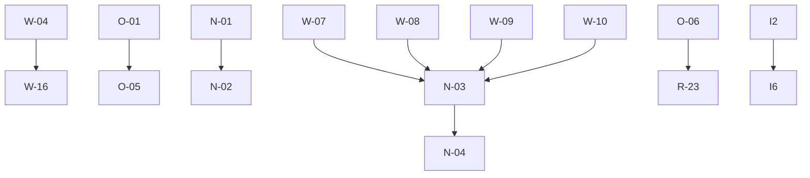

# N-02 · Map Mission Dependency Graph

**Verdict: Verified.** Generated from `catalog.json` (29 missions, 10 dependency edges, 0 unknown dependencies), 2026-11-10.

## Dependency matrix

| Misión | Depende de | N.º dependientes |
|---|---|---|
| MISSION-01 | — | 0 |
| MISSION-02 | — | 0 |
| MISSION-03 | — | 0 |
| W-04 | — | 1 |
| W-07 | — | 1 |
| W-08 | — | 1 |
| W-09 | — | 1 |
| W-10 | — | 1 |
| W-12 | — | 0 |
| W-14 | — | 0 |
| W-16 | W-04 | 0 |
| O-01 | — | 1 |
| O-05 | O-01 | 0 |
| O-06 | — | 1 |
| L-01 | — | 0 |
| N-01 | — | 1 |
| N-02 | N-01 | 0 |
| N-03 | W-07, W-08, W-09, W-10 | 1 |
| N-04 | N-03 | 0 |
| R-11 | — | 0 |
| R-17 | — | 0 |
| R-23 | O-06 | 0 |
| G4 | — | 0 |
| F7 | — | 0 |
| D10 | — | 0 |
| A7 | — | 0 |
| I2 | — | 1 |
| I6 | I2 | 0 |
| I7 | — | 0 |

## Static Mermaid diagram

Chains: W-04→W-16 · O-01→O-05 · O-06→R-23 · N-01→N-02 · {W-07,W-08,W-09,W-10}→N-03→N-04 · I2→I6. Everything else is independent.

---

- COMMAND / OUTPUT / MACHINE / DATE / PATH recorded above per receipt law.
- Agent: preceptor-orquestador · GLM (Vibe) · Revalidation authorized by the Sovereign order "Firmo. Continúa", 2026-11-10.
